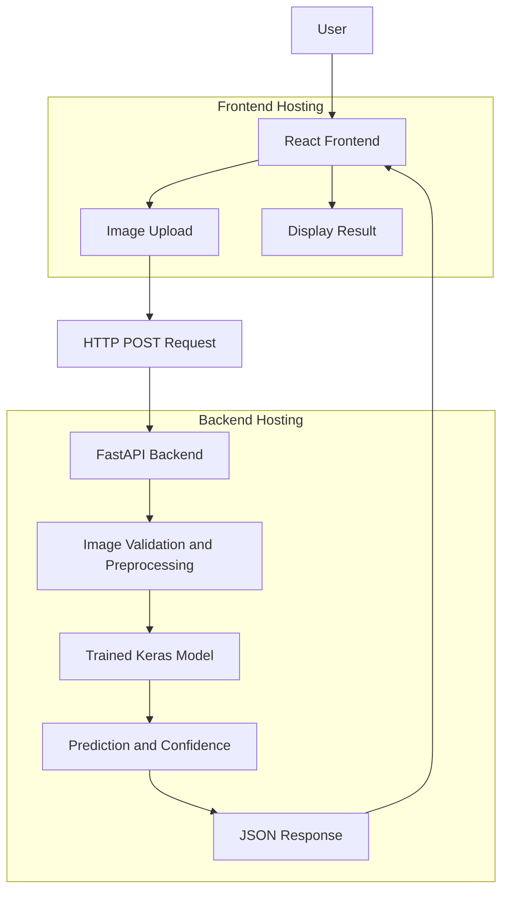
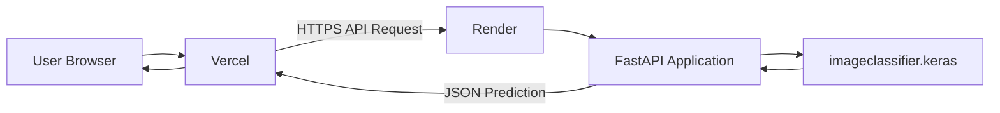

# Mood Machine — Happy or Sad Image Classifier

**Mood Machine** is an AI-powered web application that classifies uploaded images into two categories: **Happy** and **Sad**. Users can upload an image through a web interface, send it to a deployed machine-learning backend, and view the model's prediction and confidence score.

The project combines a React frontend with a FastAPI backend that loads a trained TensorFlow/Keras model for image inference.

**Live Demo:** https://image-classification-happy-sad.vercel.app/

**Backend API:** https://imageclassification-happy-sad.onrender.com/

---

## Table of Contents

- [Overview](#overview)
- [Features](#features)
- [Tech Stack](#tech-stack)
- [System Architecture](#system-architecture)
- [Project Structure](#project-structure)
- [How It Works](#how-it-works)
- [Requirements](#requirements)
- [Installation and Local Setup](#installation-and-local-setup)
- [Environment Variables](#environment-variables)
- [API Documentation](#api-documentation)
- [Deployment](#deployment)
- [Troubleshooting](#troubleshooting)
- [Limitations](#limitations)
- [Future Improvements](#future-improvements)

---

## Overview

Mood Machine demonstrates how a trained image-classification model can be integrated into a full-stack web application.

Instead of requiring users to run a machine-learning model on their own computers, the application sends images to a remote API. The backend processes each image, runs inference using the trained model, and returns a prediction to the frontend.

### How the application works

1. The user opens Mood Machine in a web browser.
2. The user uploads an image.
3. The frontend sends the image to the backend API.
4. FastAPI validates and processes the request.
5. The trained Keras model performs inference on the processed image.
6. The backend returns the predicted class and associated confidence information.
7. The frontend displays the result.

## Features

- **Binary image classification:** Predicts Happy or Sad.
- **Image upload interface:** Select an image for analysis through the web application.
- **Deep-learning inference:** Uses a trained TensorFlow/Keras model.
- **Confidence display:** Presents the model's output as a confidence percentage.
- **REST API:** Connects the frontend and backend using HTTP requests.
- **Backend readiness indicator:** Displays whether the frontend can reach the API.
- **Cloud deployment:** Frontend hosted on Vercel and backend hosted on Render.
- **Separate frontend and backend:** UI development and model serving can be maintained independently.

## Tech Stack

| Component | Technology | Purpose |
|---|---|---|
| Frontend | React | Builds the interactive user interface |
| Frontend tooling | Vite | Development server and production build |
| Styling | CSS | Layout, responsive styling, and visual design |
| Backend | Python, FastAPI | Handles API requests and predictions |
| API server | Uvicorn | Runs the FastAPI application |
| Machine learning | TensorFlow / Keras | Loads and runs the trained model |
| Image processing | Pillow or the library specified in backend requirements | Reads and prepares uploaded images |
| Model format | `.keras` | Stores the trained model |
| Frontend hosting | Vercel | Hosts the production web application |
| Backend hosting | Render | Runs the Python API and model inference |
| Version control | Git and GitHub | Source control and repository hosting |

## System Architecture

The application uses a client-server architecture. The frontend handles user interaction, while the backend handles model inference.

### Architecture diagram



### Deployment architecture



The frontend and backend are deployed independently. The frontend communicates with the backend through the configured API URL. Cross-Origin Resource Sharing (CORS) must allow the frontend's production origin.

## Project Structure

The repository is organized into separate frontend and backend directories, with the trained model in the project root.

```text
ImageClassification/
│
├── backend/
│   ├── main.py
│   ├── requirements.txt
│   └── .env.example
│
├── frontend/
│   ├── src/
│   │   ├── App.jsx
│   │   ├── index.css
│   │   └── components/
│   ├── public/
│   ├── package.json
│   ├── vite.config.js
│   ├── vercel.json
│   └── .env.example
│
├── imageclassifier.keras
├── .gitignore
└── README.md
```

*Note:* This illustrates the main project layout. Some files or subdirectories may differ in the current repository.

### Important files

- `backend/main.py` — FastAPI application and prediction endpoints.
- `backend/requirements.txt` — Python dependencies.
- `frontend/src/App.jsx` — Main React application.
- `frontend/src/index.css` — Main styling.
- `frontend/package.json` — Frontend dependencies and scripts.
- `frontend/vercel.json` — Vercel routing configuration, if used.
- `imageclassifier.keras` — Trained model used for predictions.
- `.gitignore` — Excludes local environments, dependencies, and generated files.

## How It Works

### 1. Image upload

The user selects an image through the frontend. The application displays the selected image and sends it to the backend using an HTTP request.

### 2. Image preprocessing

The backend prepares the uploaded image in the format expected by the model.

The deployed model reports an input shape of:

```text
(None, 256, 256, 3)
```

This means the model expects batches of 256 × 256 RGB images. `None` represents a variable batch size.

The image must be resized, converted to RGB, and normalized according to the preprocessing used during training. The current deployment uses a sigmoid output.

### 3. Model inference

The backend loads `imageclassifier.keras` and runs inference on the processed image.

For a binary classifier with a sigmoid output, the model returns a value between 0 and 1. The application uses its configured class mapping and threshold to select a label.

**Important:** The threshold, label mapping, and normalization must match the original training setup. A high confidence score does not guarantee that the prediction is correct.

### 4. API response

The backend returns the result to the frontend in JSON format. The frontend then displays the predicted class, confidence information, and image preview.

The precise response field names depend on the implementation in `backend/main.py`.

## Requirements

### Software

- Python 3.11 is the configured runtime for the deployed backend.
- Node.js and npm for frontend development.
- Git for version control.
- A web browser.
- A GitHub account for repository hosting.
- Render and Vercel accounts for cloud deployment.

### Model and dependencies

- The trained `imageclassifier.keras` file.
- Python dependencies listed in `backend/requirements.txt`.
- JavaScript dependencies listed in `frontend/package.json`.

The model file must be accessible to the backend in the deployed environment. If the repository does not contain the model, the backend needs a configured model-download mechanism instead.

## Installation and Local Setup

You can develop the frontend locally without installing TensorFlow on your computer. To run predictions locally, however, the Python backend needs its dependencies installed.

### 1. Clone the repository

```bash
git clone https://github.com/arpbiswas04-coder/ImageClassification-Happy-Sad-.git
cd ImageClassification-Happy-Sad-
```

### 2. Set up the frontend

Open a terminal in the frontend directory:

```bash
cd frontend
npm install
```

Create a `.env` file inside `frontend/`:

```env
VITE_API_BASE_URL=https://imageclassification-happy-sad.onrender.com
```

Start the development server:

```bash
npm run dev
```

Open the local URL printed by Vite, usually:

```text
http://localhost:5173
```

The frontend can use the deployed Render API, so a local Python environment is not required just to run the UI.

### 3. Run the backend locally (optional)

Open a separate terminal in the project root:

```bash
cd backend
```

Create and activate a virtual environment.

**Windows PowerShell:**

```powershell
py -3.11 -m venv .venv
.\.venv\Scripts\Activate.ps1
```

**Windows Command Prompt:**

```bat
py -3.11 -m venv .venv
.venv\Scripts\activate.bat
```

Install backend dependencies:

```bash
python -m pip install --upgrade pip
pip install -r requirements.txt
```

Ensure the model path resolves correctly. If the backend uses `MODEL_PATH=../imageclassifier.keras`, that relative path should resolve from the `backend` directory, as expected by the application's configuration.

Run the API:

```bash
uvicorn main:app --reload --host 127.0.0.1 --port 8000
```

Open the API documentation:

```text
http://127.0.0.1:8000/docs
```

If the backend requires additional environment variables, configure them according to `backend/.env.example` and the actual implementation.

## Environment Variables

Environment variables let the application use different API addresses and settings in local development and production.

### Frontend

| Variable | Example | Purpose |
|---|---|---|
| `VITE_API_BASE_URL` | `https://imageclassification-happy-sad.onrender.com` | Base URL of the backend API |

Vite exposes variables prefixed with `VITE_` to client-side code. Do not place secrets in frontend environment variables.

### Backend

The following settings are relevant to the deployed configuration. Configure only variables supported by the current backend code.

| Variable | Example | Purpose |
|---|---|---|
| `MODEL_PATH` | `../imageclassifier.keras` | Path to the saved model, relative to the backend working directory when configured that way |
| `ALLOWED_ORIGINS` | `https://image-classification-happy-sad.vercel.app,http://localhost:5173` | Allowed browser origins |
| `LABEL_ZERO` | `Happy` | Class label associated with the lower side of the configured threshold |
| `LABEL_ONE` | `Sad` | Class label associated with the higher side of the configured threshold |
| `THRESHOLD` | `0.5` | Example sigmoid decision threshold |
| `NORMALIZE_DIVISOR` | `255.0` | Example normalization divisor |

**Verify before changing these values:** the class mapping and preprocessing settings must match the training pipeline. If your backend code does not read a listed variable, adding it to the hosting dashboard alone will not change application behavior.

## API Documentation

The deployed backend is available at:

```text
https://imageclassification-happy-sad.onrender.com
```

### Available endpoints

| Method | Endpoint | Purpose |
|---|---|---|
| `GET` | `/` | Returns basic API information |
| `GET` | `/health` | Checks backend health and, where implemented, model readiness |
| `POST` | `/predict` | Accepts an image and returns a classification result |
| `GET` | `/docs` | Opens the interactive Swagger API documentation |

### Health check

Open:

```text
https://imageclassification-happy-sad.onrender.com/health
```

Use the returned response to check whether the API and model are ready. The precise JSON fields depend on the current implementation.

### Prediction endpoint

The `/predict` endpoint accepts an image using the request format defined by the backend. For example, if it expects a multipart file upload, you can test it using the interactive `/docs` page.

The response contains the prediction information defined by the API implementation.

For the exact request field name, response schema, and error formats, consult:

```text
https://imageclassification-happy-sad.onrender.com/docs
```

## Deployment

### Backend — Render

1. Push the project to GitHub.
2. Create a new Web Service in Render and connect the repository.
3. Set the root directory to `backend`.
4. Configure the Python version as `3.11.11`.
5. Set the build command:

   ```bash
   pip install -r requirements.txt
   ```

6. Set the start command:

   ```bash
   uvicorn main:app --host 0.0.0.0 --port $PORT
   ```

7. Configure the environment variables supported by the backend.
8. Ensure `imageclassifier.keras` is available at the configured model path.
9. Deploy and inspect the logs.
10. Verify that the model loads and that the health endpoint responds.

### Frontend — Vercel

1. Import the GitHub repository into Vercel.
2. Set the root directory to `frontend`.
3. Configure the frontend build settings using the scripts in `frontend/package.json`.
4. Set the environment variable:

   ```env
   VITE_API_BASE_URL=https://imageclassification-happy-sad.onrender.com
   ```

5. Deploy the application.
6. Add the deployed Vercel origin to the backend's CORS allowlist.
7. Redeploy the backend if needed, then test an image through the live website.

### Deployment considerations

- Render's free service may take time to wake up after inactivity.
- A cold start can make the first request slower than subsequent requests.
- Loading a TensorFlow model requires enough memory and startup time for the chosen hosting plan.
- Keep the frontend API URL synchronized with the deployed backend URL.
- The backend must allow the exact production frontend origin through CORS.

## Troubleshooting

### Backend appears offline

- Open the backend root URL and `/health`.
- Check that `VITE_API_BASE_URL` contains the correct Render URL.
- Verify that the frontend was redeployed after changing a Vercel environment variable.
- Inspect the browser console and Render logs.
- Confirm that the backend's health-check request succeeds.

### CORS error

- Add the exact deployed Vercel origin to `ALLOWED_ORIGINS`.
- Ensure origins are parsed correctly by the backend.
- Do not include a trailing slash in an origin unless the implementation explicitly requires it.
- Redeploy the backend after modifying its environment variables.

### Model file not found

- Verify that `imageclassifier.keras` is committed to GitHub or downloaded by the backend.
- Check the configured model path relative to Render's working directory.
- Review the backend startup logs.

### TensorFlow dependency installation fails

- Check the Python runtime and TensorFlow version compatibility.
- Use the dependency versions specified in `backend/requirements.txt`.
- Review the complete build log rather than changing versions at random.

### Prediction appears incorrect

- Confirm the preprocessing matches the training pipeline.
- Verify RGB conversion, image resizing, and normalization.
- Check the sigmoid threshold and class mapping.
- Test with multiple images from outside the training set.
- Evaluate the model against a labeled test dataset before claiming a particular accuracy.

## Limitations

- The classifier is limited to two categories: Happy and Sad.
- Predictions depend on the training data, image quality, and generalization of the trained model.
- Model confidence is not the same as measured classification accuracy.
- The application should be treated as a demonstration of image classification, not as a reliable measurement of a person's actual emotional state.
- Free cloud hosting may introduce cold starts and resource constraints.

## Future Improvements

- Evaluate the model on a separate labeled test dataset.
- Add a confusion matrix, precision, recall, and F1-score.
- Improve input validation and user-facing error messages.
- Add automated backend and frontend tests.
- Improve inference latency and model-loading behavior.
- Add support for additional classes if a suitable dataset and model are available.
- Introduce image-size limits, rate limiting, and production monitoring.
- Add continuous integration for builds and tests.

---

## License

Choose and add a license file if you intend to distribute the project under an open-source license.

## Acknowledgements

Built as a learning project to explore deep-learning inference, API development, frontend integration, and cloud deployment.
